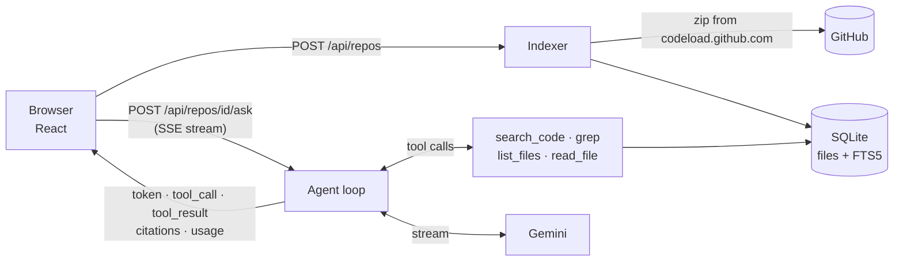

# RepoLens

**Ask a GitHub repo questions and get answers with receipts.**

Paste a public repo. An AI agent searches the code, reads the files it needs, and answers with
citations like `signer.py:236-241`. Every citation is checked against the index, and you can
watch each step the agent took.

**Live demo:** https://repo-lens-ruby.vercel.app (free hosting: the first request after idle can take
about half a minute while the server wakes up).

It runs entirely on free tiers: no paid server, no paid database, no paid model.

## What makes it different from "chat with your code"

- **Receipts, not vibes.** Each claim links to a file and line range. The server then verifies every
  citation: does the file exist, are the lines in range, and did the agent actually open that file?
  Invented citations are flagged instead of silently shown.
- **A visible trace.** Each tool call, its arguments, the time it took and how much text came back
  are streamed to the UI as they happen.
- **Measured, not assumed.** A benchmark with hand-checked answers scores the agent on correctness,
  citation validity, honesty on unanswerable questions, latency and token cost (results below).
- **Sign in with Google, chats that survive a refresh.** Signed-in users get every conversation saved
  server-side (the server records each turn itself, so even a dropped connection keeps what was already
  answered) and can reopen them from a history page. Guests keep their chat in the browser. If the free
  server restarted and forgot the indexed repo, reopening a chat re-indexes it automatically.
- **A workspace you can arrange.** File explorer, chat and code panels are resizable by dragging (or arrow
  keys), the explorer collapses, the code panel only appears when you open a file or a citation and closes
  like an editor tab, and the layout is remembered.
- **Resilient to flaky networks.** Requests retry with backoff while a sleeping free server wakes up, a
  dropped connection before the first token reconnects by itself, and an offline banner explains what is
  happening.
- **Bilingual (English / Vietnamese).** A language switch changes the whole interface instantly and is
  remembered. The browser sends an `X-Lang` header so server errors arrive in the same language, and the
  agent answers in the language of the question. A test fails the build if one language misses a string.
- **Built for hostile input.** Repo contents are written by strangers. The agent's tools are read-only
  and scoped to one repo, file contents are treated as data rather than instructions, and the
  indexer defends against zip bombs, path tricks and oversized repos.

## How it works



1. **Index.** The repo zip is downloaded with a size cap, filtered to real source files (no lock files,
   minified code, binaries or `node_modules`), split into overlapping chunks that prefer to break at
   blank lines, and stored in SQLite with an FTS5 full-text index ranked by bm25.
2. **Investigate.** The agent runs a bounded loop (at most 6 model calls). It chooses among four
   read-only tools, sees their output, and decides what to do next. Old tool results are trimmed
   before being resent so token use does not balloon.
3. **Cite.** The final answer is parsed for `[path:start-end]` citations and each one is verified.
   The UI colours them: verified and read, lines exist but file was not opened, or could not be verified.

## Design decisions worth explaining

| Decision | Why |
|---|---|
| Hybrid search inside SQLite (FTS5 + embeddings), not a vector database | One file, nothing to host, free everywhere. Vectors are stored as BLOBs and compared in Python (a few thousand chunks scan in milliseconds). Keyword and vector rankings are merged with Reciprocal Rank Fusion, so no score tuning. If the embedding API is down or out of quota, search falls back to keywords. A dedicated vector DB would be the next step for repos with hundreds of thousands of chunks. |
| Agent with tools instead of one-shot RAG | Questions like "how does X work" need the agent to follow references across files. A single retrieval step cannot. |
| Citations verified server-side | LLMs misremember line numbers. Verification turns "plausible" into "checked". |
| Read-only tools, repo id injected by the server | A model fooled by prompt injection in a file can still only read the repo it was asked about. Tool arguments named `repo_id` are discarded. |
| In-memory per-IP rate limit | The public demo uses a free Gemini key. A sliding window per IP protects the quota without adding Redis. |
| One indexing job at a time | Free hosts have about 512 MB of RAM. Indexing holds the zip and the unpacked text in memory. |
| Tools run in a worker thread | `grep` over a 30 MB repo takes 150 ms. Running it on the event loop froze the whole server in testing. |

## Evaluation

The benchmark (`backend/eval/`) asks 13 questions about [`pallets/itsdangerous`](https://github.com/pallets/itsdangerous):
11 answerable ones (one in Vietnamese) whose answers I checked against the source, and 2 that the repo
cannot answer (PostgreSQL, OAuth2) to test whether the agent honestly says "not found". Scoring is rule
based so results are repeatable and every failure has a readable reason. Full reports are in
[`backend/eval/results/`](backend/eval/results).

| Metric | First run | After fixes |
|---|---|---|
| Questions passed | 10 / 13 (76.9%) | 11 / 13 (84.6%) |
| Answerable questions correct | 10 / 11 | 9 / 11 |
| Unanswerable questions honestly refused | 0 / 2 | 2 / 2 |
| Citations that resolve to real lines | 100% (38) | 100% (33) |
| Median time to a full answer | 16.3 s | 9.3 s |
| Mean tool calls per question | 3.5 | 2.8 |
| Mean tokens per question | 8,207 | 6,481 |

**What the benchmark found**

- *The agent answered English questions in Vietnamese.* The system prompt was written in Vietnamese and
  the model followed its language. Fixed by instructing it to match the language of the question.
- *Two correct refusals were scored as failures.* The scorer only recognised a few Vietnamese phrasings of
  "not found". That was a bug in the benchmark, not in the agent. I widened the phrase list and added tests
  proving that confident wrong answers still fail.
- *Errors count as failures.* An early version excluded errored questions from the denominator and reported
  91.7%. The honest figure is 84.6%, so the scorer was changed.

**Open issues, not hidden**

- `default-hash` errored in the second run: the agent used all six steps without writing an answer
  (it passed in the first run). A forced "answer now" retry on the last step is the likely fix.
- `urlsafe` failed because the answer described the right file and encoding but never named the class
  `URLSafeSerializer`. The strict scoring stays.
- Answerable accuracy went from 10/11 to 9/11 between runs. With 13 questions and one run each, a one-question
  difference is within the model's run-to-run variation, so I make no claim beyond the three fixes above.
  The benchmark needs more questions and more than one repo before it can rank small changes.

## Does semantic search help? I measured it

The same 18 questions, run three ways (`python -m eval.run --mode keyword|vector|hybrid`).
5 of them were written to share almost no words with the code (for example "how can I replace my
signing secret without breaking tokens people already hold?").

| Search mode | Passed | Keyword-friendly (13) | Paraphrased (5) | Errors |
|---|---|---|---|---|
| keyword (FTS5 only) | 16 / 18 (88.9%) | 11 | 5 | 1 |
| vector (embeddings only) | 17 / 18 (94.4%) | 12 | 5 | 0 |
| hybrid (default) | 17 / 18 (94.4%) | 12 | 5 | 0 |

**What this does and does not show.** The paraphrased questions passed in every mode: the agent
rephrases its own searches until it finds the right file, so keyword search was already enough here.
The one-question gap comes from `default-hash`, which errored in the keyword run (the agent used all its
steps). That question passed in an earlier run too, so I treat it as run-to-run noise rather than
proof that embeddings are better. One small repo (57 chunks), one run per mode and 18 questions cannot
rank the three modes. Larger repos and vocabulary-mismatch questions are where I would expect
embeddings to matter, and the benchmark needs them before I can claim it.

## Security

- **Secrets.** The Gemini key only exists as a server environment variable (`.env` is git-ignored, the
  repo history was scanned for key patterns, none found). The browser never sees it.
- **Leaked secrets in other people's repos.** If a repo has a real key in it, the agent reports where and
  what kind, but never prints the value. Keys, tokens, JWTs, private keys, URL passwords and hard-coded
  `password = "..."` are masked (`AKIA****[masked]`) in tool results before the model sees them and again
  in the streamed answer, so it is enforced in code, not by asking the model nicely.
  The code viewer is different on purpose: it shows the file exactly as it is in the public repo (the same
  thing GitHub shows), so line numbers and content always match the citations. Masking applies to what the
  agent says, not to the source itself.
- **Scope and honesty.** The system prompt keeps the agent on the repo (off-topic questions are refused
  without spending tool calls) and tells it to say "not enough information" instead of guessing.
- **Abuse limits.** Per-IP hourly limits on asking, indexing, searching and file reads, plus a
  server-wide hourly cap so a rotating-IP attacker still cannot burn the free Gemini quota.
- **Hostile input.** Only `github.com` repos, no redirects followed, zip-bomb and path checks, read-only
  agent tools scoped to one repo, validated and size-limited request bodies, citations verified server-side.
- **Hardening.** CSP, `X-Frame-Options`, `nosniff`, HSTS and a strict referrer policy on the frontend;
  security headers on the API; CORS limited to the frontend origin and the methods and headers it uses;
  `/docs` disabled in production; container runs as a non-root user; dependency audit is clean.
- **Code integrity.** Nobody can edit the deployed code without write access to this GitHub repo, which
  deploys on push. Turn on branch protection for `main` and two-factor login on GitHub and Vercel/Render.
- **Known gap.** The rate limiter is in memory and per process, so it resets on restart.

## Accounts and chat history

Optional. With nothing configured the app runs in guest mode (the chat is kept in the browser).

| Piece | Where it lives |
|---|---|
| Indexed repo code, FTS5, vectors | temporary SQLite on the server (a public copy, safe to lose) |
| Users, conversations, turns | `DATABASE_URL`: a SQLite file locally, free Postgres (Neon, Supabase) when deployed |

To turn it on:

1. **Database.** Create a free Postgres on [Neon](https://neon.tech) and set `DATABASE_URL` on Render.
2. **Google.** In Google Cloud Console create an OAuth client of type *Web application* and add your
   Vercel URL (and `http://localhost:5173` for dev) under *Authorized JavaScript origins*. No redirect URI is
   needed. Set `GOOGLE_CLIENT_ID` on Render.
3. `SESSION_SECRET` signs the session token. `render.yaml` generates one for you.

How it works: Google's button returns an ID token, the server verifies its signature, audience and verified
email, then issues its own short-lived session token. Conversations are only readable by their owner, a user can
delete their account and all data from the history page, and tables are created automatically on first start.

## Tech stack

- **Backend:** Python 3.12, FastAPI, SQLite (FTS5 + vector BLOBs), Server-Sent Events, `google-genai`
- **Frontend:** React 19, TypeScript, Vite, React Router, Three.js, GSAP
- **Tooling:** pytest, Vitest, GitHub Actions, Docker

## Run it locally

You need Python 3.12+, Node 20+ and a free [Gemini API key](https://aistudio.google.com/apikey).

```bash
# 1. backend
cd backend
python -m venv .venv
.venv/Scripts/activate        # macOS/Linux: source .venv/bin/activate
pip install -r requirements-dev.txt
cp ../.env.example ../.env    # then put your key in GEMINI_API_KEY
uvicorn app.main:app --port 8000

# 2. frontend (new terminal)
cd frontend
npm install
npm run dev                   # http://localhost:5173
```

The dev server proxies `/api` to port 8000, so no CORS setup is needed.

```bash
cd backend && python -m pytest -q     # backend tests (a fake model, no key needed)
cd frontend && npm test               # frontend tests
cd backend && python -m eval.run      # the benchmark (uses your Gemini quota)
```

## Deploy it for free

**Backend on Render (free web service)**

1. Render → New → Blueprint → pick this repo. `render.yaml` describes the service.
2. Set `GEMINI_API_KEY` and `CORS_ORIGINS` (your Vercel URL) in the Render dashboard.

**Frontend on Vercel (free)**

1. Import the repo, set the root directory to `frontend`.
2. Add the environment variable `VITE_API_URL` with your Render URL (no trailing slash).

| Variable | Where | Meaning |
|---|---|---|
| `GEMINI_API_KEY` | backend | Gemini key, never commit it |
| `GEMINI_MODEL` | backend | defaults to `gemini-3.5-flash-lite` |
| `DATABASE_URL` | backend | accounts and chat history (default: local SQLite file) |
| `GOOGLE_CLIENT_ID` | backend | enables Sign in with Google |
| `SESSION_SECRET` | backend | signs session tokens, set a long random value |
| `CORS_ORIGINS` | backend | comma-separated frontend URLs |
| `TRUST_PROXY` | backend | `true` behind a proxy so rate limits see real IPs |
| `ASK_LIMIT_PER_HOUR` / `INDEX_LIMIT_PER_HOUR` | backend | per-IP limits (30 / 10) |
| `VITE_API_URL` | frontend | backend URL |

## Known limitations

- Free hosting sleeps when idle and its disk is temporary, so indexed repos disappear after a restart
  and the first request is slow. RepoLens re-indexes automatically when you reopen a chat, which takes a few seconds.
- Semantic search needs the Gemini embedding API. The free tier allows about 100 chunks per minute, so
  vectors are built in the background (at most 600 chunks per repo, roughly 6 minutes). Until they exist,
  and for chunks beyond the cap, search uses keywords only. The top bar shows which mode is active.
- Citation links point to `HEAD`, so line numbers can drift if the repo changes after indexing.
- Public repos only, up to 40 MB zipped.
- The Gemini free tier rate-limits by the minute. Busy moments return a "try again" message.
