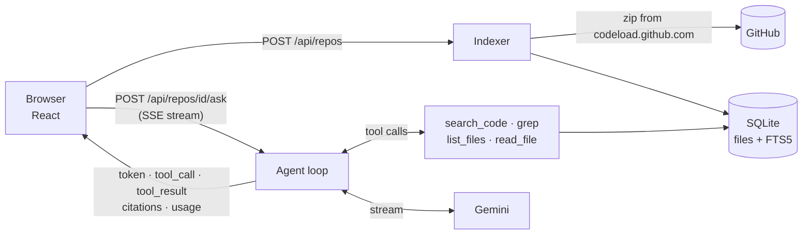

# RepoLens

**Ask a GitHub repo questions and get answers with receipts.**

Paste a public repo. An AI agent searches the code, reads the files it needs, and answers with
citations like `signer.py:236-241`. Every citation is checked against the index, and you can
watch each step the agent took.

It runs entirely on free tiers: no paid server, no paid database, no paid model.

## What makes it different from "chat with your code"

- **Receipts, not vibes.** Each claim links to a file and line range. The server then verifies every
  citation: does the file exist, are the lines in range, and did the agent actually open that file?
  Invented citations are flagged instead of silently shown.
- **A visible trace.** Each tool call, its arguments, the time it took and how much text came back
  are streamed to the UI as they happen.
- **Measured, not assumed.** A benchmark with hand-checked answers scores the agent on correctness,
  citation validity, honesty on unanswerable questions, latency and token cost (results below).
- **Bilingual (English / Vietnamese).** A language switch changes the whole interface instantly and is
  remembered. The browser sends an `X-Lang` header so server errors arrive in the same language, and the
  agent answers in the language of the question. A test fails the build if one language misses a string.
- **Built for hostile input.** Repo contents are written by strangers. The agent's tools are read-only
  and scoped to one repo, file contents are treated as data rather than instructions, and the
  indexer defends against zip bombs, path tricks and oversized repos.

## How it works



1. **Index.** The repo zip is downloaded with a size cap, filtered to real source files (no lock files,
   minified code, binaries or `node_modules`), split into overlapping chunks that prefer to break at
   blank lines, and stored in SQLite with an FTS5 full-text index ranked by bm25.
2. **Investigate.** The agent runs a bounded loop (at most 6 model calls). It chooses among four
   read-only tools, sees their output, and decides what to do next. Old tool results are trimmed
   before being resent so token use does not balloon.
3. **Cite.** The final answer is parsed for `[path:start-end]` citations and each one is verified.
   The UI colours them: verified and read, lines exist but file was not opened, or could not be verified.

## Design decisions worth explaining

| Decision | Why |
|---|---|
| SQLite FTS5 instead of a vector database | One file, nothing to host, free everywhere, and bm25 over code identifiers works well. The agent can iterate with different keywords, which covers most of what embeddings would add. |
| Agent with tools instead of one-shot RAG | Questions like "how does X work" need the agent to follow references across files. A single retrieval step cannot. |
| Citations verified server-side | LLMs misremember line numbers. Verification turns "plausible" into "checked". |
| Read-only tools, repo id injected by the server | A model fooled by prompt injection in a file can still only read the repo it was asked about. Tool arguments named `repo_id` are discarded. |
| In-memory per-IP rate limit | The public demo uses a free Gemini key. A sliding window per IP protects the quota without adding Redis. |
| One indexing job at a time | Free hosts have about 512 MB of RAM. Indexing holds the zip and the unpacked text in memory. |
| Tools run in a worker thread | `grep` over a 30 MB repo takes 150 ms. Running it on the event loop froze the whole server in testing. |

## Evaluation

The benchmark (`backend/eval/`) asks 13 questions about [`pallets/itsdangerous`](https://github.com/pallets/itsdangerous):
11 answerable ones (one in Vietnamese) whose answers I checked against the source, and 2 that the repo
cannot answer (PostgreSQL, OAuth2) to test whether the agent honestly says "not found". Scoring is rule
based so results are repeatable and every failure has a readable reason. Full reports are in
[`backend/eval/results/`](backend/eval/results).

| Metric | First run | After fixes |
|---|---|---|
| Questions passed | 10 / 13 (76.9%) | 11 / 13 (84.6%) |
| Answerable questions correct | 10 / 11 | 9 / 11 |
| Unanswerable questions honestly refused | 0 / 2 | 2 / 2 |
| Citations that resolve to real lines | 100% (38) | 100% (33) |
| Median time to a full answer | 16.3 s | 9.3 s |
| Mean tool calls per question | 3.5 | 2.8 |
| Mean tokens per question | 8,207 | 6,481 |

**What the benchmark found**

- *The agent answered English questions in Vietnamese.* The system prompt was written in Vietnamese and
  the model followed its language. Fixed by instructing it to match the language of the question.
- *Two correct refusals were scored as failures.* The scorer only recognised a few Vietnamese phrasings of
  "not found". That was a bug in the benchmark, not in the agent. I widened the phrase list and added tests
  proving that confident wrong answers still fail.
- *Errors count as failures.* An early version excluded errored questions from the denominator and reported
  91.7%. The honest figure is 84.6%, so the scorer was changed.

**Open issues, not hidden**

- `default-hash` errored in the second run: the agent used all six steps without writing an answer
  (it passed in the first run). A forced "answer now" retry on the last step is the likely fix.
- `urlsafe` failed because the answer described the right file and encoding but never named the class
  `URLSafeSerializer`. The strict scoring stays.
- Answerable accuracy went from 10/11 to 9/11 between runs. With 13 questions and one run each, a one-question
  difference is within the model's run-to-run variation, so I make no claim beyond the three fixes above.
  The benchmark needs more questions and more than one repo before it can rank small changes.

## Tech stack

- **Backend:** Python 3.12, FastAPI, SQLite (FTS5), Server-Sent Events, `google-genai`
- **Frontend:** React 19, TypeScript, Vite, React Router, Three.js, GSAP
- **Tooling:** pytest, Vitest, GitHub Actions, Docker

## Run it locally

You need Python 3.12+, Node 20+ and a free [Gemini API key](https://aistudio.google.com/apikey).

```bash
# 1. backend
cd backend
python -m venv .venv
.venv/Scripts/activate        # macOS/Linux: source .venv/bin/activate
pip install -r requirements-dev.txt
cp ../.env.example ../.env    # then put your key in GEMINI_API_KEY
uvicorn app.main:app --port 8000

# 2. frontend (new terminal)
cd frontend
npm install
npm run dev                   # http://localhost:5173
```

The dev server proxies `/api` to port 8000, so no CORS setup is needed.

```bash
cd backend && python -m pytest -q     # backend tests (a fake model, no key needed)
cd frontend && npm test               # frontend tests
cd backend && python -m eval.run      # the benchmark (uses your Gemini quota)
```

## Deploy it for free

**Backend on Render (free web service)**

1. Render → New → Blueprint → pick this repo. `render.yaml` describes the service.
2. Set `GEMINI_API_KEY` and `CORS_ORIGINS` (your Vercel URL) in the Render dashboard.

**Frontend on Vercel (free)**

1. Import the repo, set the root directory to `frontend`.
2. Add the environment variable `VITE_API_URL` with your Render URL (no trailing slash).

| Variable | Where | Meaning |
|---|---|---|
| `GEMINI_API_KEY` | backend | Gemini key, never commit it |
| `GEMINI_MODEL` | backend | defaults to `gemini-3.5-flash-lite` |
| `CORS_ORIGINS` | backend | comma-separated frontend URLs |
| `TRUST_PROXY` | backend | `true` behind a proxy so rate limits see real IPs |
| `ASK_LIMIT_PER_HOUR` / `INDEX_LIMIT_PER_HOUR` | backend | per-IP limits (30 / 10) |
| `VITE_API_URL` | frontend | backend URL |

## Known limitations

- Free hosting sleeps when idle and its disk is temporary, so indexed repos disappear after a restart
  and the first request is slow. Re-adding a repo takes a few seconds.
- Search is keyword-based. Questions that share no vocabulary with the code rely on the agent
  rephrasing its search, which usually works but is not guaranteed.
- Citation links point to `HEAD`, so line numbers can drift if the repo changes after indexing.
- Public repos only, up to 40 MB zipped.
- The Gemini free tier rate-limits by the minute. Busy moments return a "try again" message.
